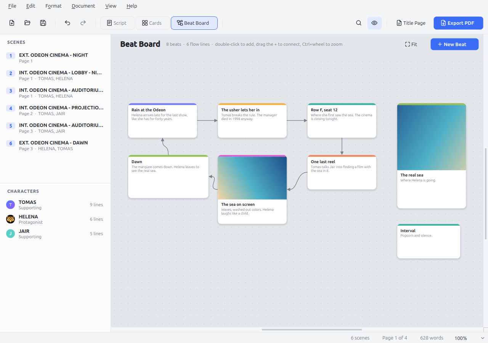

<p align="center">
  
</p>

<h1 align="center">Owlio</h1>

<p align="center">
  A screenwriting app written in C++17 and Qt 6, with industry-standard formatting,<br>
  real pages on screen, and your scenes laid out as index cards.
</p>

<p align="center">
  <a href="https://berdfandrade.github.io/owlio-website/en/">Website</a> ·
  <em><a href="README.pt-BR.md">Leia em português</a></em>
</p>

<p align="center">
  
  
</p>

---

## Why Owlio?

Professional screenplays follow a strict format: 12 pt Courier, fixed margins, and one page standing in for roughly one minute of screen time. Owlio puts that format first. It does not reflow text the way a word processor does. It lays the script out on a fixed grid of 10 characters and 6 lines per inch, so the page you see while writing is the same page that ends up in the PDF.

It also follows the keyboard-first flow screenwriters know from tools like Final Draft. You press **Enter** and **Tab**, and Owlio picks the next element for you: scene heading, action, character, dialogue.

## Features

### Writing
- **Six screenplay elements**: Scene Heading, Action, Character, Parenthetical, Dialogue, Transition.
- **Smart element flow**: Enter after a character name starts dialogue, Enter after dialogue starts the next character, and Tab turns an empty action line into a character cue. Ctrl+1 to Ctrl+6 pick an element directly.
- **Autocomplete**: suggests character names (most frequent first), locations already used, times of day, extensions such as (V.O.) and (O.S.), and common transitions. Accept with Tab, Enter or →. Suggestions follow the script conventions you pick in Settings: English (DAY, NIGHT, CUT TO:) or Portuguese (DIA, NOITE, CORTA PARA:).
- **Dual dialogue**: put two speeches side by side when characters talk at the same time. Place the cursor in either speech and use Format → Dual Dialogue (Ctrl+Shift+D). It is saved as `^` in Fountain and as `<DualDialogue>` in Final Draft files.
- Parentheticals get their parentheses automatically, and full Unicode support covers accented input.

### Pages and pagination
- US Letter or A4 pages drawn on screen with exact industry margins (1.5" left, 1" elsewhere).
- Professional page breaks: scene headings and character cues never sit alone at the bottom of a page, and dialogue split across pages gets **(MORE)** and **CHARACTER (CONT'D)**. Scripts written in Portuguese can use (MAIS)/(CONT.) instead.
- Page numbers and optional scene numbers in both margins.
- **Title page editor** with a live preview: title, credit, authors, source, revision, draft date, notes and contact. The title keeps the capitalization you type.

### Index cards
- Every scene becomes a card showing its number, INT/EXT, location, time of day (color-coded), starting page, the characters who speak in it, and its length in eighths of a page.
- **Drag and drop cards to reorder scenes.** The whole scene moves in the script, and Ctrl+Z undoes the move. Alt+arrow keys move cards from the keyboard.
- Write a **synopsis** for each scene with F2. When a scene has no synopsis, the card shows the opening of its action.
- Double-click a card to jump to that scene in the script.
- **Grid or list**: a toggle in the corner of the header switches between the card grid and a compact list with one row per scene (location, time, synopsis, cast, length and page). Dragging, arrow keys and F2 work in both, and Owlio remembers your choice.

### Timeline
- **View → Timeline** (Ctrl+Shift+L) lays the film out from left to right: a page ruler, the story structure, a strip of scene blocks and one lane per character showing where they speak. Hover a scene for its page and length; click it to open it in the script.
- Compare what is written with the **planned length**, or zoom into the written pages only.
- **Editable story structure**: drag act dividers and plot points, rename them, split or merge acts, and add or remove plot points from the right-click menu.
- **Presets**: Conventional (three acts), Fragmented (nonlinear), TV episode (drama), Sitcom, Five acts (Freytag), Save the Cat, Hero's journey and Kishōtenketsu. Any edit turns the structure into Custom. It is saved in the `.fountain` file, and every change can be undone.

### Relationship map
- **View → Relationships** (Ctrl+Shift+M) shows the characters as avatars on a canvas. Drag from one character to another to link them.
- Each link has a **type** (Family, Love, Friendship, Conflict, Work, Other) with its own color and an optional **label** such as "sisters" or "ex-husband".
- **Show who shares scenes** draws the characters who appear together, **Arrange in a circle** tidies the layout, and **Fit to window** frames everything.
- Relationships are saved in the `.fountain` file and can be undone.

### Saving and backups
- **Autosave**: scripts that already have a file are saved automatically every 5 minutes (1 or 10 minutes, or off, in Settings).
- **Crash recovery**: while there are unsaved changes, Owlio keeps a recovery copy every 20 seconds, untitled scripts included. If it closes unexpectedly, it offers the changes back the next time it starts.
- **Backups**: every save also keeps a dated copy of the script, up to the 30 most recent per script. Automatic saves add at most one backup every 10 minutes. File → Open Backup File opens one as an untitled copy, so the backup itself is never overwritten.
- **Versions** (File → Versions, Ctrl+Shift+H, or the clock button in the toolbar): a time machine for your script. It opens over the script area; Settings → Saving can make it full screen instead. Every saved version is stacked in perspective under a night sky, newest in front, with a timeline on the side. Step back with the arrows, the mouse wheel or the timeline, flip pages with ← and →, and press **Restore** to bring that version back. The restore is a normal edit, so Ctrl+Z returns to where you were.

### Files
- **Fountain** (`.fountain`) is the native format: plain text, open, and readable by many other screenwriting tools.
- **Final Draft** (`.fdx`) import and export, including scene summaries.
- **Print and PDF window** with a preview of every sheet, one below the other: pick a printer and number of copies, a page range, whether to include the title page and scene numbers, and an optional diagonal **watermark** (for example "DRAFT", or the name of the person receiving the copy). PDFs embed their fonts.

### Beat Board
- A **free board for ideas**: press Ctrl+Shift+B (or the Beat Board button) and lay out beats anywhere, at any zoom.
- **Beats** are cards with a title, a description, a color and an optional **image**. Drag to move, pull the corner to resize, double-click to edit. Double-click the empty board to add one.
- **Images**: drop image files on the board, paste an image with Ctrl+V, or pick one in the beat window. They are shrunk and stored as JPEG inside the script file.
- **Flow Lines** link one beat to another: drag the + on the edge of a beat onto the next beat. Click a line and press Delete to remove it.
- Space or the middle mouse button pans; Ctrl+wheel zooms; Fit shows every beat. Every change can be undone, and the board is saved inside the `.fountain` file in a comment block that other Fountain apps ignore.

### Characters
- **Character sheets**: click a character in the side panel to open their sheet, with a photo, name, role, age, occupation, characteristics and a synopsis.
- The sheet also shows how many lines, scenes and words the character has, where they first appear, and every scene they speak in. Double-click a scene to jump to it.
- **Renaming** a character on the sheet updates every cue in the script and keeps extensions such as (V.O.). One Ctrl+Z undoes it.
- **Characters window** (Document → Characters): an editable table of the whole cast with role, age, occupation, speeches, scenes and words. Search, add characters, open a sheet, create an avatar, upload a photo or jump to a character's first line. Renaming a character there updates every cue, the sheet and the relationship map, and merging two names asks first.
- **Avatar creator**: build a detailed pixel-art portrait for any character on a 64×64 grid, with curved shapes and six shades per color. Pick a body type, then head shape, skin, details, eyes, eyebrows, nose, mouth, 31 hairstyles, facial hair, glasses, hats, clothes, accessories and background, each with color choices. It has undo and redo, a Random button and Reset.
- The Characters panel has two buttons in its header: one opens the Characters window, the other hides the panel (View → Characters brings it back).
- Photos show up in the side panel and on the index cards. Sheets and photos are stored inside the `.fountain` file in a comment block that other Fountain apps ignore, so a script stays a single portable file.

### Interface
- **English interface**, with a **Brazilian Portuguese** translation you can switch to in Edit → Settings.
- Light and dark themes that follow the system automatically, with a quick switch in the corner of the menu bar.
- **Settings** in pages (General, Appearance, Script, Saving): interface language, reopening the last script at startup, theme, **interface font and size**, script conventions, **page font** (any installed monospaced font, always set at 12 pt on the 10-characters-per-inch grid, so the page count does not change) and saving options.
- Every menu item has its own icon; items that are on (current view, element, focus mode) light up in the accent color.
- **Focus mode** dims everything except the speech or paragraph you are writing.
- Side panels list scenes (with page and cast) and characters (with line counts). The sidebar button at the left of the toolbar (Ctrl+\\) hides or shows them both.
- Find and replace, unlimited undo and redo, and zoom.
- **US Letter or A4** (Settings › Script › Page). A4 keeps the same margins and line width and fits 4 more lines per page; the screen, the PDF and the printout all follow the choice.
- **Spell check** as you type, in Brazilian Portuguese or English, picked automatically from the words of the script (or fixed in Settings › Script): unknown words get a red wavy underline on screen, never in the PDF. Character names are never marked. Right-click a word to add it to the **script dictionary** (Edit › Script Dictionary), which is saved inside the script. Turn it off in Settings › Script.

<p align="center">
  
  
</p>

<p align="center">
  
</p>

<p align="center">
  
  
</p>

<p align="center">
  
  
</p>

## Keyboard shortcuts

| Shortcut | Action |
|---|---|
| **Enter** | Next element (Scene Heading → Action, Character → Dialogue, Dialogue → Character, …) |
| **Tab / Shift+Tab** | Cycle the element type. At the end of a speech, Tab inserts a parenthetical |
| **Ctrl+1 … Ctrl+6** | Scene Heading, Action, Character, Parenthetical, Dialogue, Transition |
| **Ctrl+Shift+D** | Dual dialogue on or off for the speech under the cursor |
| **Tab / Enter / →** | Accept the grey autocomplete suggestion |
| **Ctrl+Shift+C / Ctrl+Shift+R** | Index cards / script view |
| **Ctrl+Shift+B** | Beat Board |
| **Ctrl+Shift+M** | Relationship map |
| **Ctrl+Shift+L** | Timeline |
| **Ctrl+Shift+H** | Versions (time machine) |
| **Double-click / Enter / Delete** (Beat Board) | Add or edit a beat / edit the selected beat / delete the selection |
| **Ctrl+Shift+F** | Focus mode |
| **Ctrl+Shift+E** | Export PDF |
| **Ctrl+F** | Find and replace |
| **Ctrl+\\** | Show or hide the sidebar |
| **Ctrl+,** | Settings (language, theme, fonts, script conventions, saving) |
| **F2** (cards) | Edit the selected scene's synopsis |
| **Alt+arrows** (cards) | Move the selected card |
| **Ctrl+mouse wheel** | Zoom pages / resize cards |

## Download

A Windows installer (`Owlio-Setup-<version>.exe`) is attached to every [release](https://github.com/berdfandrade/owlio/releases). It installs for the current user without asking for administrator rights, adds Start menu and optional desktop shortcuts, and can open `.fountain` and `.fdx` files with Owlio. Release installers are being moved to free code signing through SignPath Foundation (see the [code signing policy](docs/CODE_SIGNING.md)). Until a signed release is out, Windows SmartScreen may warn about an unknown publisher: choose **More info → Run anyway**.

## Building

Requirements: CMake 3.16 or newer, a C++17 compiler, and **Qt 6** (Widgets, PrintSupport, Svg, plus Test for the UI test).

### With Qt from your distribution

```bash
# Debian / Ubuntu
sudo apt install cmake g++ qt6-base-dev qt6-svg-dev libxcb-cursor0

cmake -S . -B build
cmake --build build -j
./build/owlio
```

### With Qt from aqtinstall (no root needed)

```bash
uvx --from aqtinstall aqt install-qt linux desktop 6.8.3 linux_gcc_64 --outputdir ~/Qt
cmake -S . -B build -DCMAKE_PREFIX_PATH=$HOME/Qt/6.8.3/gcc_64
cmake --build build -j
./run.sh examples/the_last_show.fountain
```

`run.sh` points the dynamic loader at `~/Qt`. Qt 6 on X11 also needs `libxcb-cursor0`. If you cannot install it system-wide, extract the package into `~/Qt/extra` with `apt-get download libxcb-cursor0` and `dpkg -x`, and `run.sh` will find it there.

### Command line

```bash
./run.sh script.fountain                          # open a script
./run.sh script.fountain --cards                  # open straight into the index cards
./run.sh script.fountain --beats                  # open straight into the Beat Board
./run.sh script.fountain --export-pdf script.pdf  # export without opening a window
./run.sh --theme dark                             # force the dark theme for this run (or light)
./run.sh --language pt_BR                         # Portuguese interface for this run
```

## Tests

```bash
./build/owlio_tests      # core: Fountain/FDX round-trips, pagination, editing, scene reordering, character sheets, dual dialogue, beat board
./run.sh --help
LD_LIBRARY_PATH=$HOME/Qt/6.8.3/gcc_64/lib ./build/owlio_gui_test   # drives the real window with keyboard and mouse events
```

## Project layout

| Path | Purpose |
|---|---|
| `src/document.*` | Data model (paragraphs, elements, scene synopses), UTF-8/UTF-32 helpers |
| `src/layout.*` | Line wrapping and pagination on the 10 cpi × 6 lpi grid, with (MORE)/(CONT'D) |
| `src/editor.*` | Cursor, selection, Tab/Enter rules, autocomplete, undo, find, scene moves |
| `src/fountain.*`, `src/fdx.*` | Reading and writing Fountain and Final Draft files |
| `src/pagepainter.*` | Draws pages to screen, PDF or printer with exact glyph positions |
| `src/scriptview.*` | The page editor widget (keyboard, mouse, input methods, scrolling) |
| `src/sceneboard.*` | The index cards board (grid or list, drag and drop) |
| `src/timeline.*` | The timeline view and its editable story structure |
| `src/relationmap.*` | The relationship map view |
| `src/beatboard.*`, `src/beatdialog.*` | The Beat Board (QGraphicsView canvas, beats, flow lines) and the beat window |
| `src/mainwindow.*` | Menus, toolbar, side panels |
| `src/titlepagedialog.*`, `src/printdialog.*` | Title page editor and print/PDF window, both with previews |
| `src/characterdialog.*` | Character sheet window |
| `src/castdialog.*` | Characters window (editable cast table) |
| `src/pixelavatar.*` | Pixel-art avatar creator |
| `src/spell.*` | Hunspell-format spell checker (core) |
| `src/speller.*`, `src/dictionarydialog.*` | Spell check in the script view and the script dictionary window |
| `resources/dict/` | Embedded pt_BR and en_US dictionaries, with their licenses |
| `src/autosave.*` | Autosave, crash recovery copies and dated backups |
| `src/versionbrowser.*` | Versions window: saved versions stacked in perspective, with a timeline |
| `src/settingsdialog.*`, `src/i18n.*` | Settings window, interface language and translation loading |
| `src/avatars.*` | Character photos: import, crop, cache and circular drawing |
| `src/theme.*`, `resources/themes/estilo.qss` | Light/dark palettes, the Qt style sheet, recolored SVG icons |
| `translations/` | Qt translation files: `owlio_pt_BR.ts` (Portuguese) and `owlio_en.ts` (English plural forms) |
| `tests/` | Core unit tests and a QTest-based UI test |
| `packaging/`, `.github/workflows/windows.yml` | Windows installer (Inno Setup) and the workflow that builds it and publishes releases |
| `examples/` | A short sample screenplay, in English and in Portuguese |

The core (`document`, `layout`, `editor`, `fountain`, `fdx`) has no Qt dependency.

To tweak the look without recompiling, run with `OWLIO_QSS=resources/themes/estilo.qss ./run.sh`. The style sheet reloads every time you save it.

## Translations

English is Owlio's official language: every string in the source code is English, and other languages come from Qt translation files in `translations/`. After changing interface text, refresh the files and fill in the new entries with Qt Linguist:

```bash
cmake --build build --target update_translations
~/Qt/6.8.3/gcc_64/bin/linguist translations/owlio_pt_BR.ts
```

The build compiles the `.ts` files and embeds them in the app. To add a language, list a new `.ts` file in `qt_add_translations` in `CMakeLists.txt` and add it to `i18n::uiLanguages()` in `src/i18n.cpp`.

## Status

Owlio is young. On the roadmap:

- Revision mode with colored pages
- Reports (scenes, characters, locations)

## License

Owlio is free software under the [GNU General Public License v3.0](LICENSE).

Free code signing provided by [SignPath.io](https://signpath.io), certificate by [SignPath Foundation](https://signpath.org).
