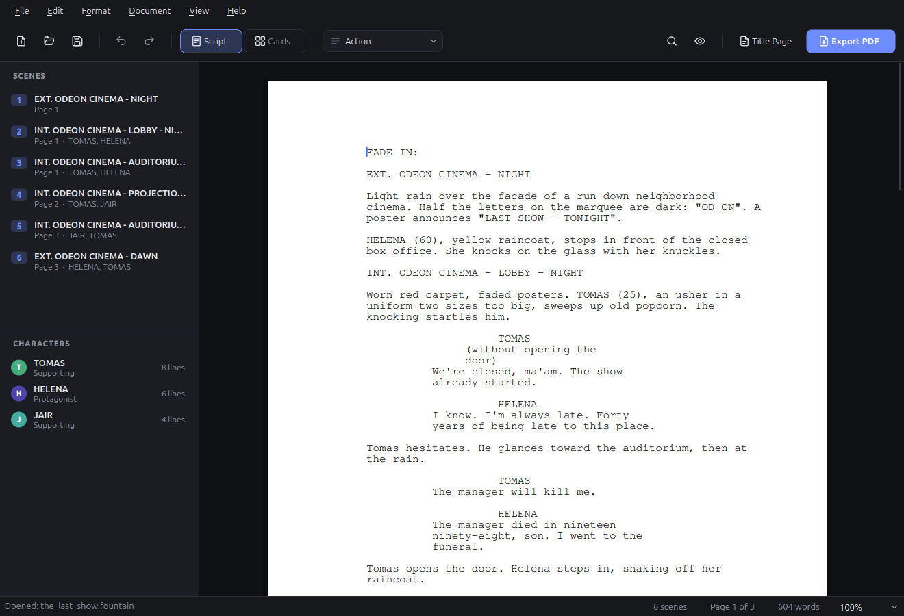
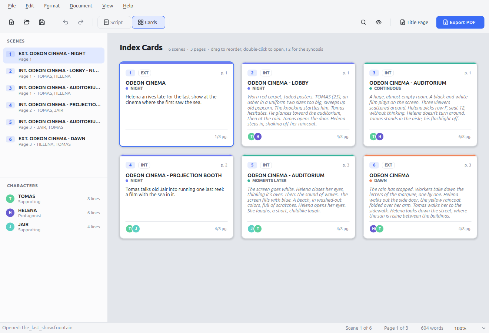
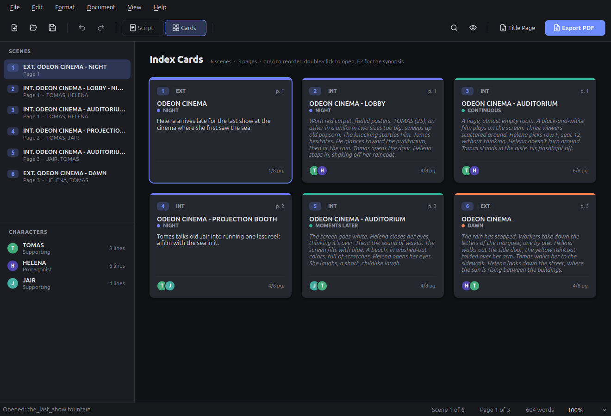
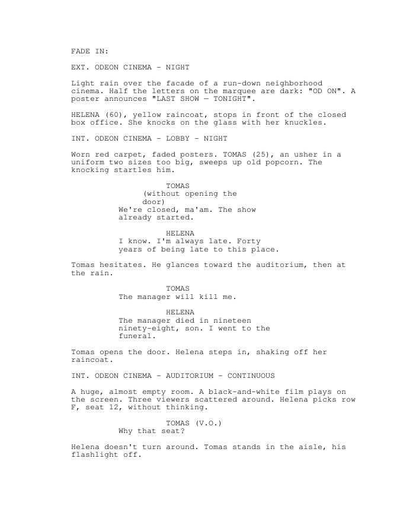
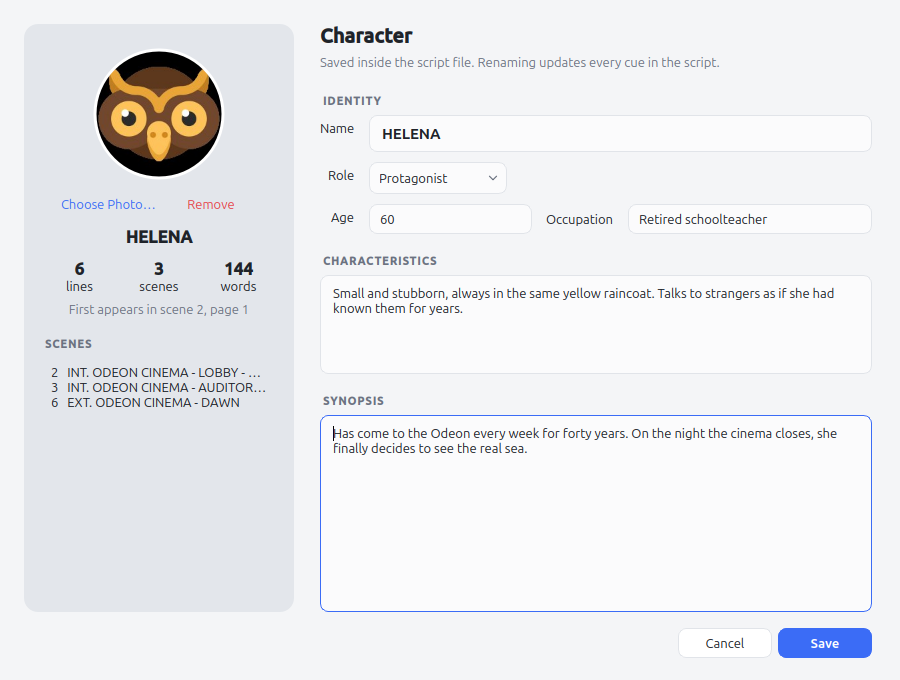
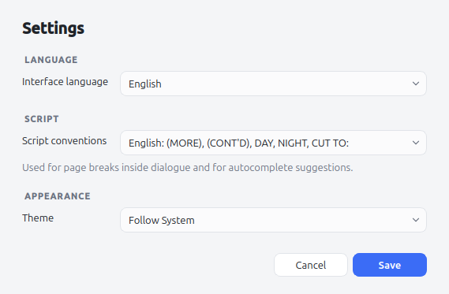
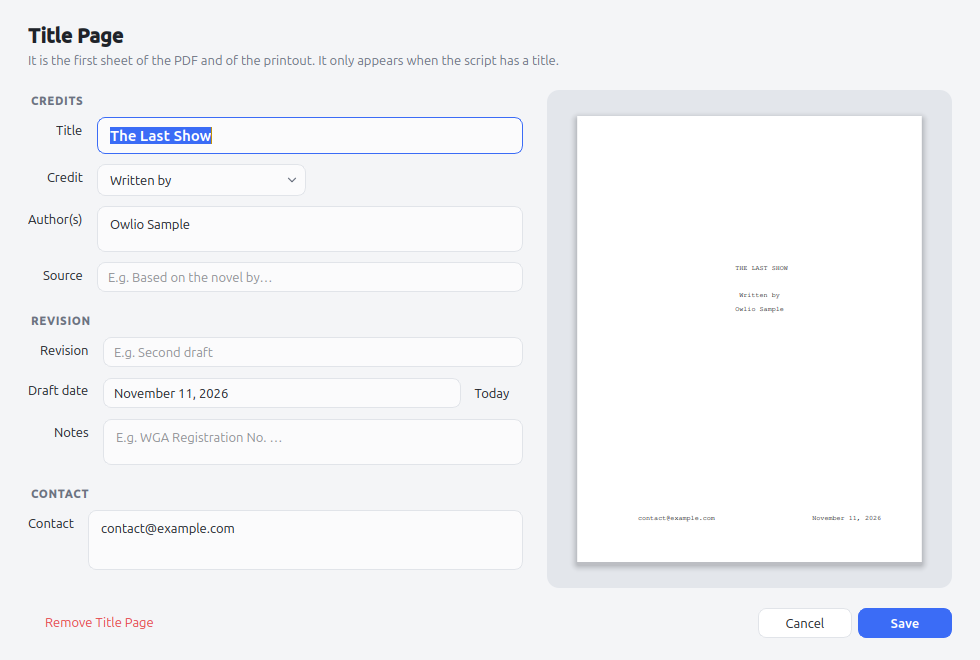
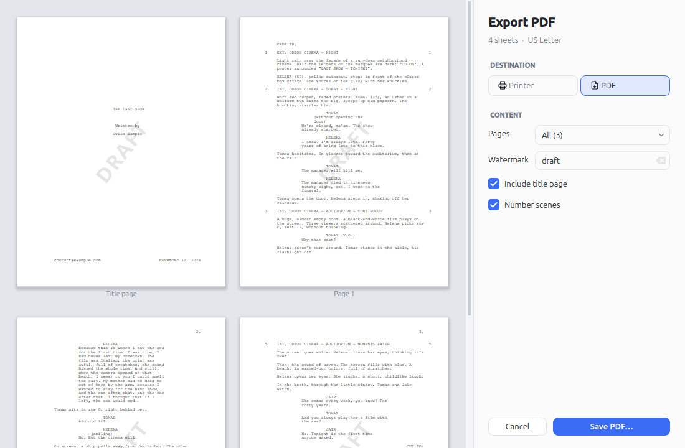

<p align="center">
  
</p>

<h1 align="center">Owlio</h1>

<p align="center">
  A screenwriting app written in C++17 and Qt 6, with industry-standard formatting,<br>
  real pages on screen, and your scenes laid out as index cards.
</p>

<p align="center">
  <em><a href="README.pt-BR.md">Leia em português</a></em>
</p>

<p align="center">
  
  
</p>

---

## Why Owlio?

Professional screenplays follow a strict format: 12 pt Courier, fixed margins, and one page standing in for roughly one minute of screen time. Owlio puts that format first. It does not reflow text the way a word processor does. It lays the script out on a fixed grid of 10 characters and 6 lines per inch, so the page you see while writing is the same page that ends up in the PDF.

It also follows the keyboard-first flow screenwriters know from tools like Final Draft. You press **Enter** and **Tab**, and Owlio picks the next element for you: scene heading, action, character, dialogue.

## Features

### Writing
- **Six screenplay elements**: Scene Heading, Action, Character, Parenthetical, Dialogue, Transition.
- **Smart element flow**: Enter after a character name starts dialogue, Enter after dialogue starts the next character, and Tab turns an empty action line into a character cue. Ctrl+1 to Ctrl+6 pick an element directly.
- **Autocomplete**: suggests character names (most frequent first), locations already used, times of day, extensions such as (V.O.) and (O.S.), and common transitions. Accept with Tab, Enter or →. Suggestions follow the script conventions you pick in Settings: English (DAY, NIGHT, CUT TO:) or Portuguese (DIA, NOITE, CORTA PARA:).
- Parentheticals get their parentheses automatically, and full Unicode support covers accented input.

### Pages and pagination
- US Letter pages drawn on screen with exact industry margins (1.5" left, 1" elsewhere).
- Professional page breaks: scene headings and character cues never sit alone at the bottom of a page, and dialogue split across pages gets **(MORE)** and **CHARACTER (CONT'D)**. Scripts written in Portuguese can use (MAIS)/(CONT.) instead.
- Page numbers and optional scene numbers in both margins.
- **Title page editor** with a live preview: title, credit, authors, source, revision, draft date, notes and contact.

### Index cards
- Every scene becomes a card showing its number, INT/EXT, location, time of day (color-coded), starting page, the characters who speak in it, and its length in eighths of a page.
- **Drag and drop cards to reorder scenes.** The whole scene moves in the script, and Ctrl+Z undoes the move. Alt+arrow keys move cards from the keyboard.
- Write a **synopsis** for each scene with F2. When a scene has no synopsis, the card shows the opening of its action.
- Double-click a card to jump to that scene in the script.

### Files
- **Fountain** (`.fountain`) is the native format: plain text, open, and readable by many other screenwriting tools.
- **Final Draft** (`.fdx`) import and export, including scene summaries.
- **Print and PDF window** with page thumbnails: pick a printer and number of copies, a page range, whether to include the title page and scene numbers, and an optional diagonal **watermark** (for example "DRAFT", or the name of the person receiving the copy). PDFs embed their fonts.

### Characters
- **Character sheets**: click a character in the side panel to open their sheet, with a photo, name, role, age, occupation, characteristics and a synopsis.
- The sheet also shows how many lines, scenes and words the character has, where they first appear, and every scene they speak in. Double-click a scene to jump to it.
- **Renaming** a character on the sheet updates every cue in the script and keeps extensions such as (V.O.). One Ctrl+Z undoes it.
- Photos show up in the side panel and on the index cards. Sheets and photos are stored inside the `.fountain` file in a comment block that other Fountain apps ignore, so a script stays a single portable file.

### Interface
- **English interface**, with a **Brazilian Portuguese** translation you can switch to in Edit → Settings.
- Light and dark themes that follow the system automatically.
- **Focus mode** dims everything except the speech or paragraph you are writing.
- Side panels list scenes (with page and cast) and characters (with line counts).
- Find and replace, unlimited undo and redo, and zoom.

<p align="center">
  
  
</p>

<p align="center">
  
  
</p>

<p align="center">
  
  
</p>

## Keyboard shortcuts

| Shortcut | Action |
|---|---|
| **Enter** | Next element (Scene Heading → Action, Character → Dialogue, Dialogue → Character, …) |
| **Tab / Shift+Tab** | Cycle the element type. At the end of a speech, Tab inserts a parenthetical |
| **Ctrl+1 … Ctrl+6** | Scene Heading, Action, Character, Parenthetical, Dialogue, Transition |
| **Tab / Enter / →** | Accept the grey autocomplete suggestion |
| **Ctrl+Shift+C / Ctrl+Shift+R** | Index cards / script view |
| **Ctrl+Shift+F** | Focus mode |
| **Ctrl+Shift+E** | Export PDF |
| **Ctrl+F** | Find and replace |
| **Ctrl+,** | Settings (interface language, script conventions, theme) |
| **F2** (cards) | Edit the selected scene's synopsis |
| **Alt+arrows** (cards) | Move the selected card |
| **Ctrl+mouse wheel** | Zoom pages / resize cards |

## Building

Requirements: CMake 3.16 or newer, a C++17 compiler, and **Qt 6** (Widgets, PrintSupport, Svg, plus Test for the UI test).

### With Qt from your distribution

```bash
# Debian / Ubuntu
sudo apt install cmake g++ qt6-base-dev qt6-svg-dev libxcb-cursor0

cmake -S . -B build
cmake --build build -j
./build/owlio
```

### With Qt from aqtinstall (no root needed)

```bash
uvx --from aqtinstall aqt install-qt linux desktop 6.8.3 linux_gcc_64 --outputdir ~/Qt
cmake -S . -B build -DCMAKE_PREFIX_PATH=$HOME/Qt/6.8.3/gcc_64
cmake --build build -j
./run.sh examples/the_last_show.fountain
```

`run.sh` points the dynamic loader at `~/Qt`. Qt 6 on X11 also needs `libxcb-cursor0`. If you cannot install it system-wide, extract the package into `~/Qt/extra` with `apt-get download libxcb-cursor0` and `dpkg -x`, and `run.sh` will find it there.

### Command line

```bash
./run.sh script.fountain                          # open a script
./run.sh script.fountain --cards                  # open straight into the index cards
./run.sh script.fountain --export-pdf script.pdf  # export without opening a window
./run.sh --theme dark                             # force the dark theme for this run (or light)
./run.sh --language pt_BR                         # Portuguese interface for this run
```

## Tests

```bash
./build/owlio_tests      # core: Fountain/FDX round-trips, pagination, editing, scene reordering, character sheets
./run.sh --help
LD_LIBRARY_PATH=$HOME/Qt/6.8.3/gcc_64/lib ./build/owlio_gui_test   # drives the real window with keyboard and mouse events
```

## Project layout

| Path | Purpose |
|---|---|
| `src/document.*` | Data model (paragraphs, elements, scene synopses), UTF-8/UTF-32 helpers |
| `src/layout.*` | Line wrapping and pagination on the 10 cpi × 6 lpi grid, with (MORE)/(CONT'D) |
| `src/editor.*` | Cursor, selection, Tab/Enter rules, autocomplete, undo, find, scene moves |
| `src/fountain.*`, `src/fdx.*` | Reading and writing Fountain and Final Draft files |
| `src/pagepainter.*` | Draws pages to screen, PDF or printer with exact glyph positions |
| `src/scriptview.*` | The page editor widget (keyboard, mouse, input methods, scrolling) |
| `src/sceneboard.*` | The index cards board (grid, drag and drop) |
| `src/mainwindow.*` | Menus, toolbar, side panels |
| `src/titlepagedialog.*`, `src/printdialog.*` | Title page editor and print/PDF window, both with previews |
| `src/characterdialog.*` | Character sheet window |
| `src/settingsdialog.*`, `src/i18n.*` | Settings window, interface language and translation loading |
| `src/avatars.*` | Character photos: import, crop, cache and circular drawing |
| `src/theme.*`, `resources/themes/estilo.qss` | Light/dark palettes, the Qt style sheet, recolored SVG icons |
| `translations/` | Qt translation files: `owlio_pt_BR.ts` (Portuguese) and `owlio_en.ts` (English plural forms) |
| `tests/` | Core unit tests and a QTest-based UI test |
| `examples/` | A short sample screenplay, in English and in Portuguese |

The core (`document`, `layout`, `editor`, `fountain`, `fdx`) has no Qt dependency.

To tweak the look without recompiling, run with `OWLIO_QSS=resources/themes/estilo.qss ./run.sh`. The style sheet reloads every time you save it.

## Translations

English is Owlio's official language: every string in the source code is English, and other languages come from Qt translation files in `translations/`. After changing interface text, refresh the files and fill in the new entries with Qt Linguist:

```bash
cmake --build build --target update_translations
~/Qt/6.8.3/gcc_64/bin/linguist translations/owlio_pt_BR.ts
```

The build compiles the `.ts` files and embeds them in the app. To add a language, list a new `.ts` file in `qt_add_translations` in `CMakeLists.txt` and add it to `i18n::uiLanguages()` in `src/i18n.cpp`.

## Status

Owlio is young, and the page size is US Letter. On the roadmap:

- A4 pages
- Dual dialogue
- Revision mode with colored pages
- Reports (scenes, characters, locations)
- Autosave and backups
