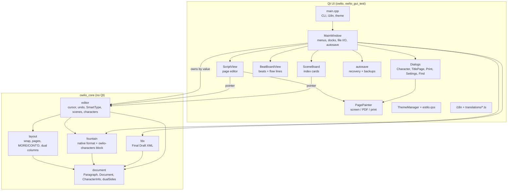
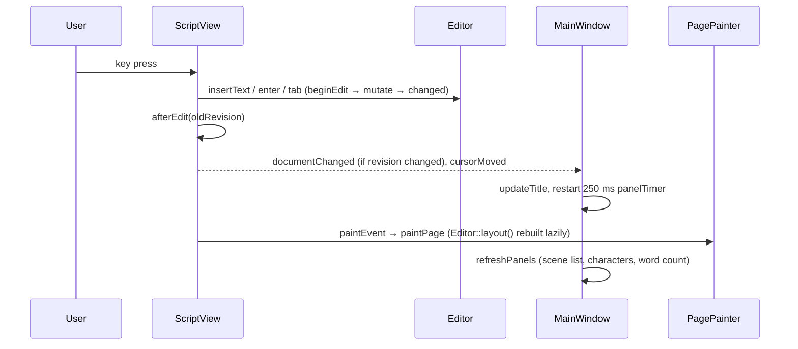
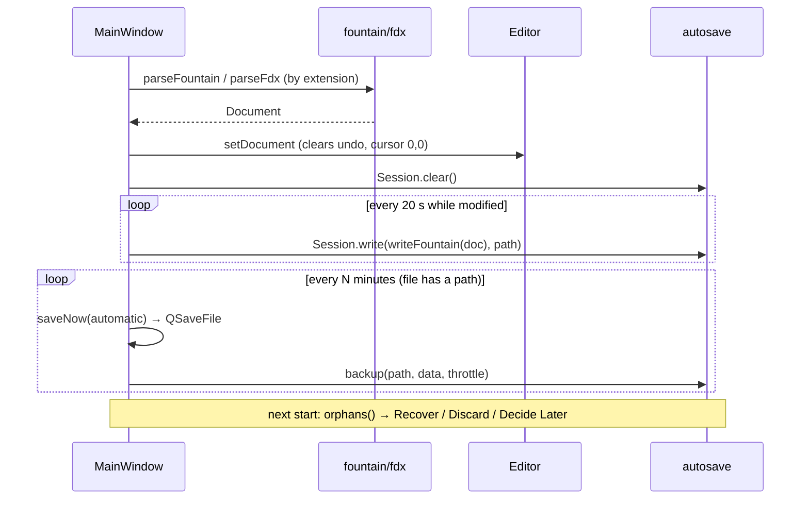

# Codebase Map

> Auto-generated by Cartographer. Last mapped: 2026-11-12T11:52:56Z

Owlio is a screenwriting app in C++17 and Qt 6. A **Qt-free core** (model, pagination, file formats, editing) sits under a **Qt Widgets UI** that draws real US Letter pages through a single renderer used for screen, PDF and printer. Code comments are in Portuguese; UI strings are English and translated through Qt `.ts` files.

## System Overview



## Directory Structure

```
CMakeLists.txt        targets, UI_SOURCES list, qt_add_translations
run.sh                launches build/owlio with ~/Qt on LD_LIBRARY_PATH (does not build)
src/
  document.*          data model, UTF-8/UTF-32 helpers, dualSides()
  layout.*            page grid constants, element styles, computeLayout()
  editor.*            Editor: editing model, undo, SmartType, scenes, characters, dual dialogue
  fountain.*          Fountain read/write, character-sheet comment block
  fdx.*               Final Draft .fdx read/write (string scanning, not a real XML parser)
  main.cpp            app bootstrap, command-line options, startup recovery prompt
  mainwindow.*        main window, FindDialog (inner class), file I/O, autosave timers
  scriptview.*        page-based editing widget (keys, mouse, IME, zoom)
  pagepainter.*       the one renderer for pages, title page, watermark; renderScript()
  sceneboard.*        index-card board with drag and drop
  beatboard.*         Beat Board canvas (QGraphicsView): beats, images, flow lines
  beatdialog.*        beat editor window + beatimage helpers (shrink, JPEG base64, decode cache)
  sceneheading.h      splitHeading() + timeColor(), shared by cards and character sheet
  carddelegate.*      dock list items (scenes, characters) drawn as cards
  characterdialog.*   character sheet window
  titlepagedialog.*   title page editor with live preview
  printdialog.*       print / export PDF window with sheet previews
  settingsdialog.*    settings window (language, script conventions, theme, saving)
  i18n.*              UI language, script conventions, translator install
  autosave.*          crash-recovery copies (QLockFile) and dated backups
  avatars.*           character photo import, cache, circular drawing
  theme.*             palettes, QSS token replacement, recolored SVG icons
resources/            owlio.qrc, owlio.png, icons/*.svg, themes/estilo.qss
translations/         owlio_pt_BR.ts (Portuguese), owlio_en.ts (English plural forms only)
tests/                tests.cpp (core), gui_test.cpp (QTest, drives the real window)
examples/             the_last_show.fountain (English), a_ultima_sessao.fountain (Portuguese)
docs/                 screenshots/, the_last_show.pdf, this map
```

## Module Guide

### Core model — `src/document.*`

**Purpose**: data model and text helpers. No Qt.

| File | Purpose | Tokens |
|------|---------|--------|
| document.h | `Element`, `Paragraph`, `CharacterInfo`, `Document`, helpers | 923 |
| document.cpp | element names, setters, UTF conversion, `dualSides` | 2207 |

**Exports**:
- `enum class Element { SceneHeading, Action, Character, Parenthetical, Dialogue, Transition, Count }`, `kElementCount`, `elementName()` (English), `elementFdxName()`, `elementIsUppercase()`.
- `Paragraph { type, u32string text, synopsis /*headings only*/, bool dual /*right-hand Character*/ }`.
- `CharacterInfo { name, photo (base64), age, occupation, role, traits, synopsis; blank() }`.
- `Document { paragraphs, titlePage (key/value), cast }` with `titleValue/setTitleValue`, `character/setCharacter`, `avatar/setAvatar`, `ensureNotEmpty`.
- `dualSides(doc)` → 0/1/2 per paragraph; `displayText(p)`; `utf8ToU32`, `toUpper`, `trim`, `isWordChar`...

**Dependents**: everything.

### Pagination — `src/layout.*`

**Purpose**: deterministic monospace layout on a 10 cpi × 6 lpi US Letter grid.

| File | Purpose | Tokens |
|------|---------|--------|
| layout.h | `page::` constants, `ElementStyle`, `LayoutLine`, `LayoutOptions`, `Layout` | 678 |
| layout.cpp | style tables (normal + dual columns), `wrapText`, `computeLayout` | 2471 |

**Exports**: `computeLayout(doc, opt)`, `wrapText`, `elementStyle(e)`, `elementStyle(e, side)`, `Layout::lineText`, `pageOfPara`.
Page: 85×66 cells, text rows start at 6, 54 lines per page, columns 15..75. Dual columns: 15..44 and 46..75.

### Editing model — `src/editor.*`

**Purpose**: the single source of truth for the open script. Owns the `Document` and a lazily rebuilt `Layout`.

| File | Purpose | Tokens |
|------|---------|--------|
| editor.h | `Pos`, `SceneSummary`, `CharacterStats`, `ScriptLanguage`, `Editor` | 1695 |
| editor.cpp | all editing behaviour | 9731 |

**Exports (Editor)**: `doc/setDocument/layout/revision/modified/markSaved/markModified`; cursor and movement; `insertText`, `enter`, `tab`, `backspace`, `setElement`, `toggleDualDialogue/isDualDialogue`, `copySelection/paste`; `undo/redo`; `suggestion/acceptSuggestion` (SmartType); `find/replaceCurrent/replaceAll`; `sceneSummaries/setSynopsis/moveScene`; `setCharacter(oldName, info)` (renames cues), `characterStats`; `setScriptLanguage`; `lineOf/columnOf/posAtLine` for screen mapping.

### File formats — `src/fountain.*`, `src/fdx.*`

| File | Purpose | Tokens |
|------|---------|--------|
| fountain.cpp | Fountain parser/writer, `/* owlio-characters */` block, legacy `/* owlio-avatars */` | 4469 |
| fdx.cpp | FDX writer and string-scanning parser; `SceneProperties/Summary`, `DualDialogue` | 2525 |

**Exports**: `parseFountain(utf8, parseTitlePage=true)`, `writeFountain(doc, writeTitlePage=true)`, `looksLikeSceneHeading`, `parseFdx`, `writeFdx`.

### Main window — `src/mainwindow.*`, `src/main.cpp`

**Purpose**: owns `Editor editor_` by value; builds menus, toolbar, docks (Scenes, Characters), status bar; opens/saves files; runs autosave and recovery; launches dialogs.
**Entry point**: `main.cpp` → `MainWindow` → `newFile()`.

| File | Purpose | Tokens |
|------|---------|--------|
| main.cpp | org/app name, Fusion, theme, CLI, `i18n::install`, `offerRecovery` | 660 |
| mainwindow.cpp | UI construction (`buildActions`), I/O, panels, dialogs, autosave, `FindDialog` | 10523 |

CLI: `file`, `--export-pdf out.pdf`, `--screenshot img.png`, `--theme light|dark`, `--language en|pt_BR`, `--cards` (old `--tema`, `--cartoes` still accepted).

### Views — `src/scriptview.*`, `src/sceneboard.*`, `src/carddelegate.*`, `src/sceneheading.h`

| File | Purpose | Tokens |
|------|---------|--------|
| scriptview.cpp | page editor: geometry (96 px/in × zoom), keys → Editor, IME, hit testing, context menu | 4352 |
| sceneboard.cpp | card grid, drag to reorder, Alt+arrows, F2 synopsis | 5533 |
| carddelegate.cpp | dock list cards (scene badge / character avatar + role) | 1107 |
| sceneheading.h | `splitHeading`, `timeColor` | 551 |

Signals: `ScriptView::{documentChanged, cursorMoved, zoomChanged}`, `SceneBoard::{openScene, moveRequested, editSynopsisRequested, selectionChanged}`.

### Beat Board — `src/beatboard.*`, `src/beatdialog.*`

**Purpose**: a free canvas for ideas. Data lives in `Document::board` (`BeatBoard { beats, flows }`, `Beat { id, x, y, w, h, color, title, text, shared_ptr<const string> image }`, `FlowLine { from, to }`) and is saved in a `/* owlio-beatboard */` Fountain comment block.
**Editor API**: `addBeat`, `updateBeats`, `removeBeats` (also drops linked flows), `addFlow` (no duplicates, reverses or self links), `removeFlows`; each is one undo step and the board is part of the undo snapshot.
**View**: `BeatBoardView` (QGraphicsView) rebuilds `BeatItem`/`FlowItem` from the editor in `reload()` and emits `changed()` after each edit; `MainWindow` answers with `refreshAfterExternalEdit()`. Moves and resizes are committed on mouse release (`commitGeometry`). Linking starts on the + connector of a selected or hovered beat. Images come from drops, Ctrl+V or `BeatDialog`, via `beatimage::fromImage` (max 720 px, JPEG q86).

### Rendering — `src/pagepainter.*`

**Purpose**: the only page renderer. Glyphs are placed one by one with `QGlyphRun` on the character grid, so screen, PDF and paper match exactly.
**Exports**: `PagePainter(const Editor&)::paintPage(p, page, origin, ppi, Extras)`, `paintTitlePage`, `hasTitlePage`, `drawWatermark`; `PrintOptions`; free function `renderScript(QPagedPaintDevice&, ppi, editor, options)`.
Font: first installed of Courier Prime, Courier Final Draft, …, Nimbus Mono PS, Courier New, Liberation Mono…

### Dialogs

| File | Purpose | Tokens |
|------|---------|--------|
| characterdialog.cpp | character sheet: photo, fields, stats box, scene cards; merge confirmation on rename | 4475 |
| titlepagedialog.cpp | title page fields + `TitlePagePreview` (own private Editor) | 2574 |
| printdialog.cpp | printer/PDF toggle, range, copies, watermark, `SheetPreview` | 3417 |
| settingsdialog.cpp | language, script conventions, theme, autosave interval, backups | 1702 |

Dialogs read the editor via `const Editor&` and expose getters; `MainWindow` applies results.

### Services — `src/i18n.*`, `src/autosave.*`, `src/theme.*`, `src/avatars.*`

| File | Purpose | Tokens |
|------|---------|--------|
| i18n.cpp | `uiLanguages`, `install` (loads `:/i18n/owlio_<code>.qm` + qtbase), `scriptLanguage`, `elementLabel` | 621 |
| autosave.cpp | `Session` (recovery copy + QLockFile), `orphans`, `discard`, `backup`, `backups` | 1084 |
| theme.cpp | light/dark palettes, QSS `@token` replacement, `icon(name, color)` from `currentColor` SVGs | 1873 |
| avatars.cpp | `draw` (photo or initials), `fromImageFile` (crop, 192 px JPEG base64), `fileFilter` | 892 |

### Tests

| File | Purpose | Tokens |
|------|---------|--------|
| tests/tests.cpp | core tests (`CHECK` macro): scenes, Fountain, FDX, layout, editor, characters, dual dialogue | 5162 |
| tests/gui_test.cpp | QTest end-to-end: typing flow, shortcuts, cards drag, dialogs, character rename, autosave, recovery | 5084 |

## Data Flow

### Typing



### Open, save, autosave and recovery



### Export PDF / print

`File → Export PDF` or `Print` → `PrintDialog` → `renderScript()` into `QPdfWriter` (1200 dpi, Letter, zero margins) or `QPrinter`. `--export-pdf` uses the same `renderScript` with default options.

## Conventions

- **Core vs UI**: never include Qt in `document`, `layout`, `editor`, `fountain`, `fdx`. Core tests link only `owlio_core`.
- **Text**: `std::u32string` everywhere in the model; offsets are code points. Stored text is raw; uppercase is applied on display/export (`displayText`).
- **Mutations**: every Editor change goes `beginEdit(kind)` → mutate → `changed()`. Only Typing/Deleting coalesce (same kind within 1500 ms).
- **UI refresh**: after changing the Editor outside ScriptView's own key/mouse handling, call `view_->refreshAfterExternalEdit()`. `view_->refresh()` is for swapping documents.
- **Dialogs**: `Q_OBJECT` (for `tr()` context), `QDialogButtonBox` with Save marked `primarioBotao`, icons cleared, texts set with `tr()`, and `setDefault(true)` **at the end** of the constructor.
- **Styling**: QSS by `objectName` (Portuguese names: `primarioBotao`, `secao`, `perigo`, `link`, `tituloDialogo`, `subtituloDialogo`, `ficha`...). Colors come from `@tokens`. Custom-painted widgets read `ThemeManager::instance().colors()`.
- **Icons**: SVGs in `resources/icons` use `currentColor`; register actions with `iconAction()` so they recolor on theme change.
- **i18n**: English source strings; plurals as `tr("%n scene(s)", "", n)`; strings from the Qt-free core go through `QT_TRANSLATE_NOOP`/`QCoreApplication::translate` (see `i18n.cpp`).
- **Settings keys** (`QSettings`, org/app "Owlio"): `language`, `scriptLanguage` (en/pt), `theme`, `autosaveMinutes` (default 5), `keepBackups` (default true), `geometry`, `windowState`, `zoom`, `lastDir`, `lastImageDir`.

## Gotchas

- **Dual dialogue line order**: `computeLayout` stores all left-column lines, then all right-column lines. `Layout::lines` is not in row order inside a dual block; use the lowest row when you need the end of something (see `sceneSummaries`). Blocks are never split across pages; a block taller than a page can desynchronize the columns.
- **Dual pairing**: the `dual` flag sits on the right-hand Character. `dualSides` silently ignores invalid pairs (no previous speech, chains of three). Writers emit `^` / `<DualDialogue>` only for valid pairs.
- **Fountain title page** is detected only on line 1. All-caps keys count only if known (so `FADE IN:` is not a key).
- **Fountain comments**: `readCast` runs on the raw text **before** comments are stripped. An unterminated `/*` removes the rest of the file. Values in the cast block escape `\`, newlines and `*/` (written as `*\/`). The legacy `owlio-avatars` block is read but never written.
- **Lost on round trip**: Fountain sections (`#`), page breaks, notes, scene numbers. FDX export drops the cast and most title-page keys; FDX import maps unknown types (Shot, General) to Action and flattens text styling.
- **Default buttons**: the QSS styles `QPushButton:default` as primary. Calling `setDefault(true)` before the button is in the dialog lets Qt pick another button (this once made Enter trigger "Remove Title Page").
- **Recovery copies** are always Fountain, even for `.fdx` files. A copy is an orphan when its `QLockFile` can be acquired. `Session::clear()` keeps the `.lock`, so lock files can accumulate in `recovery/`.
- **Autosave** writes the file only when it already has a path; untitled scripts rely on recovery. Automatic saves create at most one backup per 10 minutes; identical backups are skipped; 30 kept per script (keyed by a hash of the absolute path).
- **Language**: switching the UI language needs a restart (`QProcess::startDetached`); script conventions and theme apply live.
- **Beat images are shared pointers** so undo snapshots don't copy the bytes. Compare contents, not pointers, when checking for changes (`Editor::updateBeats` does). `beatimage::decode` caches by pointer and keeps the `shared_ptr` alive in the cache.
- **Edit menu in the Beat Board**: Paste and Select All are routed to the board when it is visible; Cut/Copy do nothing there. Keyboard shortcuts go through the window's QActions, not the view's `keyPressEvent`, when the window is active.
- **Hard-coded colors**: page white, ink, selection/cursor colors and the `perigo` red do not follow the theme; `statLabel` in the character sheet captures the muted color at construction.
- **GUI test** compiles `UI_SOURCES` again; new UI files must go into `UI_SOURCES`. It needs a display (`QT_QPA_PLATFORM=offscreen` for headless) and uses org "OwlioTest" so it does not touch real settings.

## Navigation Guide

**Add a screenplay element**: `document.h` (enum before `Count`) → `document.cpp` (names, uppercase) → `layout.cpp` (style, keep-with-next) → `editor.cpp` (`nextOnEnter`, `nextOnTab`, `prevOnTab`, SmartType) → `fountain.cpp` (parse + writer + `!` escaping) → `fdx.cpp` (`elementFromFdx`) → UI: `mainwindow.cpp` element actions/combo, icons in `resources/icons` + `owlio.qrc`, `i18n.cpp` `kElementNames` → tests.

**Add a field to the character sheet**: `CharacterInfo` + `blank()` (`document.*`) → `writeFountain` `fields[]` and `readCast` (`fountain.cpp`) → no-change check in `Editor::setCharacter` → `CharacterDialog` → `testCharacters`.

**Add a paragraph-level property** (like `synopsis`/`dual`): `Paragraph` → Fountain/FDX read and write → Editor operations that split/merge paragraphs → tests. Undo already snapshots whole paragraphs.

**Change pagination**: `page::` constants and `elementStyle` (`layout.*`) → `computeLayout` → check `sceneSummaries`, `moveVertical`, `posFromPoint` → `testWrapAndLayout`, `testDualDialogue`.

**Add a menu action**: `MainWindow::buildActions()` → slot in `mainwindow.h` → optional icon (`iconAction`) → disable in `setCardsMode` if needed → `showShortcuts()` → `update_translations`.

**Add a dialog**: new `src/xdialog.*` with `Q_OBJECT` → add to `UI_SOURCES` → follow the dialog conventions above → `MainWindow` slot that runs it and applies the result → `update_translations`.

**Add a setting**: control + getter in `SettingsDialog` → write/apply in `MainWindow::showSettings()` (or a helper like `applySaveSettings`) → read with the same default where it is used.

**Add or change UI text**: write English in `tr()` → `cmake --build build --target update_translations` → translate in `translations/owlio_pt_BR.ts` (Qt Linguist) → rebuild.

**Change colors/theme**: `lightColors()`/`darkColors()` in `theme.cpp`; new token → `ThemeColors` + `tokens[]` in `apply()` (longer tokens first) → use in `estilo.qss`. Live reload: `OWLIO_QSS=resources/themes/estilo.qss ./run.sh`.

**Build and test**:
```bash
cmake -S . -B build -DCMAKE_PREFIX_PATH=$HOME/Qt/6.8.3/gcc_64
cmake --build build -j
./build/owlio_tests
LD_LIBRARY_PATH=$HOME/Qt/6.8.3/gcc_64/lib:$HOME/Qt/extra/usr/lib/x86_64-linux-gnu ./build/owlio_gui_test
```
